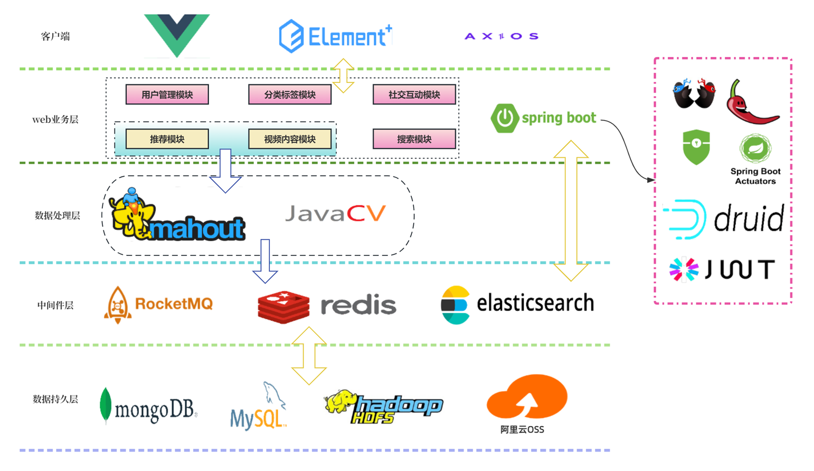
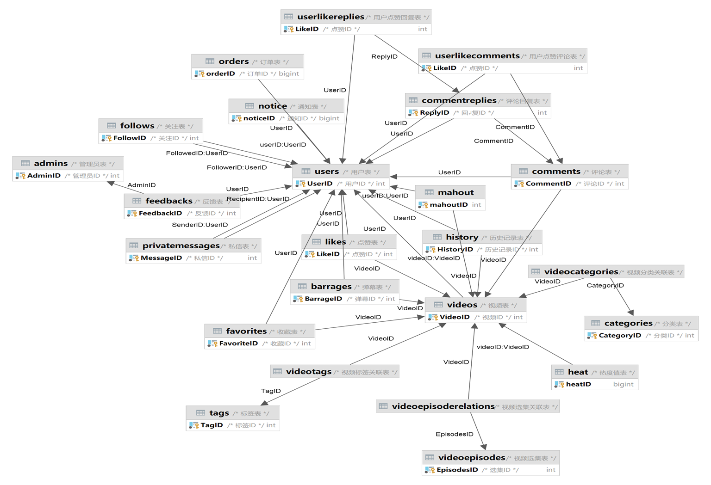

# YouBili 2.0 — 弹幕视频创作与分享平台

> 基于 **Spring Boot 3.5 + Java 21** 与 **Vue 3 + TypeScript + Vite 7 + Element Plus + Tailwind CSS 4** 全面重构的现代化弹幕视频网站。

---

## 一、技术栈全面升级（v1.0 → v2.0）

### 前端 (`YouBili_front`)

| 维度 | 旧版 (v1.0) | 新版 (v2.0) |
| --- | --- | --- |
| 框架与语言 | Vue 2.6 + JavaScript | **Vue 3.5 (`<script setup>`) + TypeScript 5.9** |
| 构建工具 | Vue CLI 5 + Webpack 5 | **Vite 7.3** |
| 路由与状态 | Vue Router 3 + 空 Vuex 3 | **Vue Router 4.6 + Pinia 3** |
| UI 与样式 | Element UI 2 + 手写固定像素样式 | **Element Plus 2.14 + Tailwind CSS 4 + 亮/暗双主题** |
| 视频与弹幕 | NPlayer（已停维护）+ 多套冗余播放器 | **自研 `DanmakuPlayer`（HTML5 + HLS.js + 60fps 滚动/顶/底弹幕引擎）** |

### 后端 (`youbili-project-backend`)

| 维度 | 旧版 (v1.0) | 新版 (v2.0) |
| --- | --- | --- |
| 运行时与框架 | JDK 17 + Spring Boot 3.1.0 | **JDK 21 LTS + Spring Boot 3.5.16** |
| 持久层 | 混用 MyBatis + MyBatis-Plus 3.5.3 + PageHelper 1.4 | **统一 MyBatis-Plus SB3 Starter 3.5.18 + PaginationInnerInterceptor + Druid SB3** |
| 认证与安全 | JJWT 0.11 硬编码静态密钥 + 过时 `.and()` 配置 | **Spring Security 6.5 + JJWT 0.12.6 + Redis 登出吊销黑名单** |
| API 文档 | Knife4j OpenAPI 2 (Swagger 2) | **Knife4j 4.5 + Springdoc 2.8 (OpenAPI 3 + Bearer JWT)** |
| 推荐算法 | Apache Mahout 0.13 (Hadoop 2) + 有缺陷热度公式 | **纯 Java 余弦相似度 User-CF + 重力衰减热度模型 + 冷启动兜底** |
| 存储与转码 | 硬编码 Windows 路径 + 3GB 重复 FFmpeg 依赖 + 硬编码 RocketMQ IP | **可插拔 Local/Aliyun OSS 存储 + 可选异步 FFmpeg CLI 转码** |
| 搜索与弹幕 | ES 异常静默吞掉、强依赖全套中间件 | **ES 8 优先 + MySQL 自动降级；MongoDB 弹幕优先 + MySQL 自动降级** |

---

## 二、重点修复的前后端不合理设计

### 后端修复清单
1. **严重安全与越权修复**：
   - 修复 `SecurityConfig` 中 `/orders/details/**`、`/alipay/**`、`/actuator/**` 全部 `permitAll()` 的越权漏洞。
   - 修复订单列表查询返回全站所有用户订单、删除订单不校验归属、支付宝支付信任前端传入 `total_amount` 的金额篡改漏洞（改为服务端 `VipPlan` 锁定价格 + 回调金额校验 + 支付成功自动激活用户 `Active` 大会员）。
   - 修复 `NoticeMapper` 删除通知 SQL 写成 `WHERE userID = #{noticeId}` 导致误删他人全部通知的严重 Bug。
   - 修复 `VideoUploadController` 信任客户端 `userID` 伪造投稿人、静态 `uploadProgress` 多线程竞争、以及 `if (file.isEmpty() && ext != "mp4")` 逻辑与字符串比较错误。
   - 修复 `JwtUtils` 在 `static final` 字段上使用 `@Value` 导致配置永远不生效、退出登录未吊销 Token 的问题。
   - 去除所有 XML 中硬编码的 `youbili_v1.` 库名前缀，修复 `FollowMapper` `followDate = NOW()` 布尔表达式错误与 `HistoryMapper` `#{videoID }` 空格参数错误。
2. **核心逻辑与性能修复**：
   - 修复 `LikeService.removeDislike` 误扣减 `likeCount` 的 Bug，并支持点赞/点踩无缝切换与事务一致性。
   - 修复 `CommentService` 500 条评论触发 N+1 查询的问题，改为 `WHERE commentID IN (...)` 单次批量拉取并按 `likeCount DESC` 排序。
   - 修复 `DynamicCacheRepositoryImpl` 使用 `public static String` 传递结果引发的并发串数据问题。
   - 修复 `NoticeServiceImpl` 用 `==` 比较 `Long` 包装类（`userId > 127` 永远为 `false`）的 Bug。
   - 修复 `ThermaValueImpl` 整数除法 `hours / 100000` 恒为 0 且指数正增长的错误热度衰减公式。
   - 消除所有包名/类名拼写错误（`uplaod`、`reposity`、`catche`、`pagedate`、`IDynameicService` 等），并将统一 RESTful 规范落地至 `/api/v1/**`。
   - 新增完整的稿件管理 CRUD 接口（`GET /api/v1/videos/my`、`PUT/DELETE /api/v1/videos/{id}`）与违规举报持久化接口（`POST /api/v1/reports`）。

### 前端修复与界面焕新
1. **彻底重构 UI 与交互**：全新设计亮色/暗夜双主题视觉体系（Bili 粉 `#FB7299` + 电光青 `#00AEEC`），毛玻璃粘性顶栏、可折叠图标导航栏、响应式移动端抽屉、16:9 悬浮动画视频卡片、实时弹幕播放器、个人空间封面横幅。
2. **修复大量原有前端 Bug**：
   - 彻底移除 `Handder.vue` 直接调用 `sidebar.methods` / `document.getElementById` 和全局 `location.reload()` 的反模式，改为 Pinia 响应式驱动。
   - 修复 `option.js` 中 `deletefan` 无限递归调用自身、`GET` 请求误用 `data` 传参、`ForLike` URL 拼写错误等问题。
   - 修复 `fans.vue` 关注按钮误传 `followID` 而非 `followerID` 的 Bug。
   - 修复 `contribute.vue` 标题限制 10 字、标签校验误判 `videoSrcUrl`、分类标签写死的问题。
   - 修复 `contributeManage.vue`（原本为硬编码新闻假数据）与 `report.vue`（原本仅 `console.log`），现均完整对接真实后端接口。
   - 修复 `orders.vue` 残留 `alert()` 弹窗与错误提示文案。

---

## 三、目录结构

```text
YouBili/
├── docker-compose.yml            # 一键启动 MySQL 8.4 + Redis 7.4 + MongoDB 8.0
├── sql/
│   └── youbili_schema.sql        # 规范化建表语句 + 默认分区/标签种子数据
├── docs/images/                  # 原项目系统架构图与数据库 E-R 图
├── youbili-project-backend/      # Spring Boot 3.5 + Java 21 后端
│   ├── pom.xml
│   └── src/main/java/com/youbili/
│       ├── common/               # 统一响应、异常处理、JWT 与安全过滤器
│       ├── config/               # Security、MyBatis-Plus、Redis、OpenAPI、ES 等配置
│       └── modules/              # auth / user / category / video / interaction / social / recommend / search / order
└── YouBili_front/                # Vue 3 + TypeScript + Vite 7 前端
    ├── package.json
    ├── vite.config.ts
    └── src/
        ├── api/                  # 强类型 Axios 封装与按域划分接口
        ├── components/           # AppHeader、AppSidebar、AuthModal、VideoCard、DanmakuPlayer
        ├── layouts/              # MainLayout 响应式布局外壳
        ├── router/               # Vue Router 4 路由与鉴权守卫
        ├── stores/               # Pinia (auth / ui) 状态管理
        ├── types/                # 前后端对齐的 TypeScript 模型定义
        └── views/                # 15 个重构升级后的完整业务视图
```

---

## 四、快速启动

### 1. 启动基础设施（MySQL + Redis + MongoDB）
```bash
docker compose up -d
```
数据库会自动导入 [`sql/youbili_schema.sql`](sql/youbili_schema.sql)。

### 2. 启动后端（需要 JDK 21 + Maven 3.9+）
```bash
cd youbili-project-backend
mvn spring-boot:run
```
- 后端默认端口：`http://localhost:10001`
- OpenAPI / Knife4j 文档：`http://localhost:10001/doc.html`
- 邮件、OSS、支付宝沙箱、ES 等敏感配置均支持通过环境变量注入（详见 `src/main/resources/application.yaml`）。

### 3. 启动前端（需要 Node.js 20+）
```bash
cd YouBili_front
npm install
npm run dev
```
- 前端访问地址：`http://localhost:5173`（已配置 `/api` 与 `/uploads` Vite 代理至 `10001`）。

---

## 五、系统架构参考




